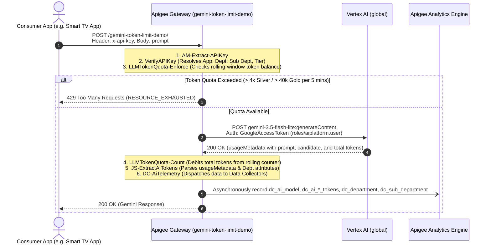

# Apigee LLM Token Quota & AI Telemetry Demo (`gemini-token-limit-demo`)

This repository contains the complete Apigee API Proxy bundle, declarative API Product configurations, and Developer App definitions with custom attributes for **LLM Token Quota Governance** and **AI Analytics Data Collection** connecting to Google Vertex AI Gemini 3.5 Flash Lite via the `global` endpoint.

Deployed and operational in Apigee organization: **`YOUR_APIGEE_ORG`** (Environment: **`default-dev`**).

---

## 🏛️ Architecture Diagram & Policy Flow

<p align="center">
  
</p>

### End-to-End Policy Execution Pipeline

This implementation references the enterprise patterns from `AI-Gemini-Reference` (revision 2), incorporating `VerifyAPIKey`, paired `LLMTokenQuota` (Enforce & Count), JavaScript token extraction, and Apigee Analytics `DataCapture` (telemetry for model, prompt/response/total tokens, and app custom attributes: Department & Sub Department).



---

## 📋 Pre-requisites

Before deploying or running this demo, ensure the following infrastructure and access requirements are satisfied:

### 1. Google Cloud Platform & Apigee X Environment
* **GCP Project**: An active Google Cloud project with billing enabled (e.g., `YOUR_GCP_PROJECT_ID`).
* **Apigee Organization**: A provisioned Apigee X or hybrid organization attached to the project.
* **Apigee Environment**: At least one active environment (e.g., `default-dev`) with an environment group mapped to an ingress hostname or IP (e.g., `YOUR_APIGEE_GATEWAY_HOST`).

### 2. Enabled Google Cloud APIs
Enable the required APIs in your GCP project:
```bash
gcloud services enable \
  apigee.googleapis.com \
  aiplatform.googleapis.com \
  run.googleapis.com \
  iap.googleapis.com \
  iam.googleapis.com
```

### 3. IAM Roles & Service Account Bindings
* **Apigee Runtime Service Account**:
  * An authorized Service Account (e.g., `sa-apigee-aiservices@YOUR_GCP_PROJECT_ID.iam.gserviceaccount.com` or the Apigee Service Agent) must have the **Vertex AI User** role to invoke Gemini:
    ```bash
    gcloud projects add-iam-policy-binding <PROJECT_ID> \
      --member="serviceAccount:sa-apigee-aiservices@<PROJECT_ID>.iam.gserviceaccount.com" \
      --role="roles/aiplatform.user"
    ```
* **Deployment Identity**:
  * Your deployment account or CI/CD identity requires **Apigee Organization Admin** (`roles/apigee.admin`).
* **Cloud Run & IAP Access (Web UI)**:
  * For the hosted dashboard, users require **IAP-secured Web App User** (`roles/iap.httpsResourceAccessor`) to pass Google Identity-Aware Proxy authentication.

### 4. Apigee Analytics Data Collectors
The organization must have the 6 Data Collectors registered so `DC-AiTelemetry.xml` can record custom dimensions:
* `dc_ai_model` (`STRING`)
* `dc_ai_prompt_token_count` (`INTEGER`)
* `dc_ai_response_token_count` (`INTEGER`)
* `dc_ai_total_token_count` (`INTEGER`)
* `dc_department` (`STRING`)
* `dc_sub_department` (`STRING`)

*Note: In `YOUR_APIGEE_ORG`, these Data Collectors are already provisioned and receiving live telemetry.*

### 5. Local Workstation Tools
* **`gcloud` CLI**: [Google Cloud SDK](https://cloud.google.com/sdk) authenticated with `gcloud auth login`.
* **`apigeecli`** (Optional but recommended): For automated proxy deployment and declarative product setup (`brew install apigeecli` or [GitHub releases](https://github.com/apigee/apigeecli)).
* **Python 3.10+**: For running the interactive Web-UI server locally (`web-ui/.venv`).
* **`curl` & `bash`**: Standard command-line tools for running verification suites (`./test-quota.sh`).

---

## 📊 Data Collectors & Analytics Telemetry

Configured in `DC-AiTelemetry.xml` and registered in `YOUR_APIGEE_ORG`:

| Data Collector Name | Type | Description | Source Flow Variable |
| :--- | :--- | :--- | :--- |
| **`dc_ai_model`** | `STRING` | LLM Model Name | `ai.model` (`gemini-3.5-flash-lite`) |
| **`dc_ai_prompt_token_count`** | `INTEGER` | Input / Prompt tokens | `ai.promptTokenCount` |
| **`dc_ai_response_token_count`** | `INTEGER` | Generated / Completion tokens | `ai.responseTokenCount` |
| **`dc_ai_total_token_count`** | `INTEGER` | Total tokens consumed | `ai.totalTokenCount` |
| **`dc_department`** | `STRING` | Consumer Department | `ai.department` (`verifyapikey.VerifyAPIKey.Department`) |
| **`dc_sub_department`** | `STRING` | Consumer Sub Department | `ai.subDepartment` (`verifyapikey.VerifyAPIKey.Sub Department`) |

---

## 📦 Provisioned API Products

Both products configure both standard Proxy Operation Groups and LLM Operation Groups (`llmOperationGroup`) with token quotas:

| API Product | Quota Limit | Interval | Environment | Operations |
| :--- | :--- | :--- | :--- | :--- |
| **`Gemini-Silver-Tier`** | **4,000 tokens** | **5 minutes** | `default-dev` | `/` and `/**` on `gemini-token-limit-demo` |
| **`Gemini-Gold-Tier`** | **40,000 tokens** | **5 minutes** | `default-dev` | `/` and `/**` on `gemini-token-limit-demo` |

---

## 📱 Developer Applications & Credentials

Provisioned under developer **`developer@example.com`** in **`YOUR_APIGEE_ORG`**:

### Silver Tier Apps (4,000 tokens / 5 mins)
1. **`Gemini-Basic-Mfg-SmartTV-App`**
   * **API Key (`consumerKey`)**: `YOUR_SMART_TV_APP_API_KEY`
   * **Product**: `Gemini-Silver-Tier`
   * **Attributes**:
     * `Department`: `Manufacturing`
     * `Sub Department`: `Smart TV division`

2. **`Gemini-Basic-Mfg-AudioSignal-App`**
   * **API Key (`consumerKey`)**: `YOUR_AUDIO_SIGNAL_APP_API_KEY`
   * **Product**: `Gemini-Silver-Tier`
   * **Attributes**:
     * `Department`: `Manufacturing`
     * `Sub Department`: `AudioSignal division`

### Gold Tier Apps (40,000 tokens / 5 mins)
3. **`Gemini-Premium-Network-Core-App`**
   * **API Key (`consumerKey`)**: `YOUR_NETWORK_CORE_APP_API_KEY`
   * **Product**: `Gemini-Gold-Tier`
   * **Attributes**:
     * `Department`: `Network`
     * `Sub Department`: `Core division`

4. **`Gemini-Premium-Network-Wireless-App`**
   * **API Key (`consumerKey`)**: `YOUR_NETWORK_WIRELESS_APP_API_KEY`
   * **Product**: `Gemini-Gold-Tier`
   * **Attributes**:
     * `Department`: `Network`
     * `Sub Department`: `Wireless division`

---

## 🚀 Live Verification & Usage

### 1. Test Without API Key (401 Unauthorized)
```bash
curl -k -i -X POST "https://YOUR_APIGEE_GATEWAY_HOST/gemini-token-limit-demo/" \
  -H "Content-Type: application/json" \
  -d '{"contents":[{"role":"user","parts":[{"text":"Hi"}]}]}'
```
**Response:**
```json
{
  "error": {
    "code": 401,
    "message": "Invalid or missing API key. Please provide a valid 'x-api-key' header.",
    "status": "UNAUTHENTICATED"
  }
}
```

### 2. Test With SmartTV App API Key (Silver Tier: 4,000 tokens)
```bash
curl -k -i -X POST "https://YOUR_APIGEE_GATEWAY_HOST/gemini-token-limit-demo/" \
  -H "Content-Type: application/json" \
  -H "x-api-key: YOUR_SMART_TV_APP_API_KEY" \
  -d '{
    "contents": [
      {
        "role": "user",
        "parts": [{"text": "Summarize how Apigee manages token quotas in 1 sentence."}]
      }
    ]
  }'
```
**Response:**
```json
{
  "candidates": [
    {
      "content": {
        "parts": [
          {
            "text": "Apigee manages token quotas by enforcing request limits and dynamically counting token consumption via the LLMTokenQuota policy integrated with API Products."
          }
        ],
        "role": "model"
      },
      "finishReason": "STOP"
    }
  ],
  "usageMetadata": {
    "promptTokenCount": 15,
    "candidatesTokenCount": 27,
    "totalTokenCount": 42
  },
  "modelVersion": "gemini-3.5-flash-lite"
}
```

### 3. Test With Network Core App API Key (Gold Tier: 40,000 tokens)
```bash
curl -k -i -X POST "https://YOUR_APIGEE_GATEWAY_HOST/gemini-token-limit-demo/" \
  -H "Content-Type: application/json" \
  -H "x-api-key: YOUR_NETWORK_CORE_APP_API_KEY" \
  -d '{
    "contents": [
      {
        "role": "user",
        "parts": [{"text": "Hello from Network Core"}]
      }
    ]
  }'
```

### 4. Running the Complete Verification Suite
To test all 4 apps and error handling automatically:
```bash
./test-quota.sh
```

---

## 🖥️ Interactive Web-UI & Admin Analytics Dashboard

<p align="center">
  
</p>

A dedicated, full-featured web application is included to demonstrate **Token Quota Simulation**, **Real-time Quota Enforcement**, and **Multi-dimensional Governance Analytics**.

---

### 📖 Step-by-Step Guide: How to Use the Web UI

Follow these steps to demonstrate how Apigee inspects, counts, and strictly enforces token quotas on Gemini models:

```
┌─────────────────────────┐     ┌────────────────────────┐     ┌────────────────────────┐
│  1. Select App & Tier   │ ──► │  2. Pick Prompt Preset │ ──► │  3. Send or Burst Test │
│ (Silver: 4k / Gold: 40k)│     │  (Light/Medium/Burner) │     │ (Real-time Gateway Call)│
└─────────────────────────┘     └────────────────────────┘     └────────────────────────┘
                                                                            │
                                                                            ▼
┌─────────────────────────┐     ┌────────────────────────┐     ┌────────────────────────┐
│ 6. Multi-Dim Analytics  │ ◄── │  5. Tier SLA Upgrade   │ ◄── │  4. Observe Quota 429  │
│(App/Dept/Product Charts)│     │(Gold Tier 40k Capacity)│     │ (Bar Turns Red + Alert)│
└─────────────────────────┘     └────────────────────────┘     └────────────────────────┘
```

#### Step 1: Select a Consumer Application & Review Tier Limits
1. On the left-hand panel (**Select Consumer Application**), pick an app. (You can click and drag the vertical splitter bar to resize this panel).
2. Choose a **Basic App (Silver Tier)**:
   * `Smart TV App` (Department: *Manufacturing*, Sub-department: *Smart TV division*)
   * **Active Quota**: **4,000 tokens / 5 minutes**.
3. Notice the **Active Quota** bar at the top of the main card displays rolling 5-minute token consumption (`0 / 4,000 tokens consumed (0%)`).

#### Step 2: Choose a Prompt Preset
Select one of the calibrated prompt presets to evaluate token consumption:
* ⚡ **Light Query** (`~30 tokens`): Quick question (`Summarize how Apigee secures Gemini AI APIs in 2 short bullet points`).
* 📝 **Medium Analysis** (`~350 tokens`): Technical analysis prompt (`Analyze microservices latency in multi-region deployments`).
* 💥 **Heavy Quota Burner** (`~1,500 - 2,500 tokens`): Heavy engineering prompt designed to rapidly consume quota headroom.

#### Step 3: Simulate Traffic (Single Request vs. Burst Load)
* **Single Request**: Click **`🚀 Send Single Request`**.
  * Apigee verifies the API Key, queries Gemini 3.5 Flash Lite on Vertex AI (global endpoint), extracts `promptTokenCount` and `candidatesTokenCount` from the response, logs analytics telemetry via `DataCapture`, and increments the distributed quota counter.
  * The **Active Quota** progress bar updates immediately to reflect the new token count.
  * The **Gateway Response & Token Telemetry** pane displays the Gemini response text along with a detailed token ledger: **Prompt Tokens**, **Response Tokens**, **Total Tokens**, and **Gateway Latency**.
* **Burst Simulation**: Click **`⚡ Simulate Burst (Auto-Exhaust Quota)`**.
  * Select between `3`, `5`, or `10` rapid-fire requests from the dropdown.
  * The UI triggers concurrent or rapid sequential requests against the Apigee Gateway.

#### Step 4: Observe Token Quota Breach & HTTP 429 Response
1. With the **Silver Tier (4,000 tokens)** app selected, trigger a 3-call burst using the *Heavy Quota Burner* preset.
2. In **2 to 3 calls**, the cumulative token count crosses 4,000 tokens.
3. Apigee's `LLMTokenQuota-Enforce` policy evaluates the rolling token counter and rejects subsequent calls with:
   * **HTTP Status**: `429 Too Many Requests`
   * **Fault Code**: `policies.ratelimit.QuotaViolation`
   * **Error Message**: `LLM Token Quota Exceeded: Your application has exceeded its allowed token rate limit.`
4. The UI immediately transitions:
   * Progress bar turns **Crimson Red (100% / Exhausted)**.
   * Status indicator updates to **⚠️ Quota Exhausted (429 Active)**.
   * An upgrade banner suggests switching to a **Gold Tier** consumer application.

#### Step 5: Upgrade to Premium Tier App (Gold Tier)
1. In the left panel, click on `Network Core App` or `Network Wireless App` (**Gold Tier - 40,000 tokens / 5 mins**).
2. Re-run the identical burst simulation.
3. The requests succeed effortlessly because the application has **10x the token capacity**, illustrating how enterprises can tier API products and monetize LLM capabilities based on token quotas.

#### Step 6: Explore Multi-Dimensional Admin Analytics
1. Click the **Admin Analytic (aggregated)** button at the top header or the floating tab on the right edge.
2. Select a time window: `Last 1 Hour`, `Last 1 Day`, `Last 3 Days`, or `Last 7 Days`.
3. View interactive charts powered by Chart.js:
   * **By API Product**: Compare token volume consumed by `Gemini-Silver-Tier` vs `Gemini-Gold-Tier`.
   * **By Developer App**: Identify which specific application is consuming the highest token volume.
   * **By Department**: Breakdown across business units (`Manufacturing` vs `Network`).
   * **By Sub-Department**: Drill down into operational divisions (`Smart TV`, `AudioSignal`, `Core division`, `Wireless division`).
   * **Timeline Trend**: Hourly / daily token usage trends and peak traffic spikes.
4. Review the **Audit Transaction Ledger**: A granular table listing recent API requests, prompt/response token breakdowns, latency, and quota compliance status.

#### Step 7: Reset Demo Baseline
* At any time, click the **Reset Session** button in the header to purge live test traffic and restore the clean 7-day demo baseline.

---

### 🚀 Launching the Web UI

#### Option A: Direct Access via Cloud Run (Secured with IAP)
The UI is deployed directly to **Google Cloud Run** in `asia-southeast1` within project `YOUR_GCP_PROJECT_ID` secured with **Identity-Aware Proxy (IAP)**:
* **Service Name**: `apigee-token-limit-demo-ui`
* **Region**: `asia-southeast1`
* **Direct Cloud Run URL**: **[https://apigee-token-limit-demo-ui-PROJECT_NUMBER.asia-southeast1.run.app](https://apigee-token-limit-demo-ui-PROJECT_NUMBER.asia-southeast1.run.app)**
* **Authentication**: Google Identity-Aware Proxy (IAP). Simply open the URL while logged into your authorized Google Cloud account.

#### Option B: Local Development Launch
To launch locally on your machine:
```bash
./run-ui.sh

# Or specify a custom port:
PORT=8089 ./run-ui.sh
```
Then open **[http://localhost:8089](http://localhost:8089)** in your web browser.

---

