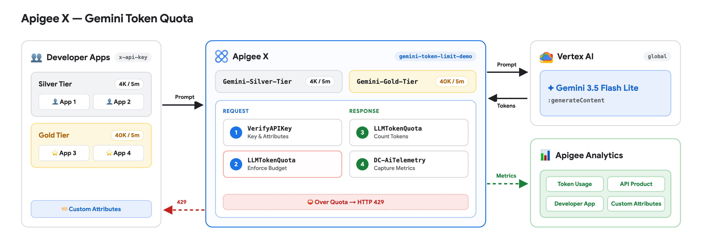
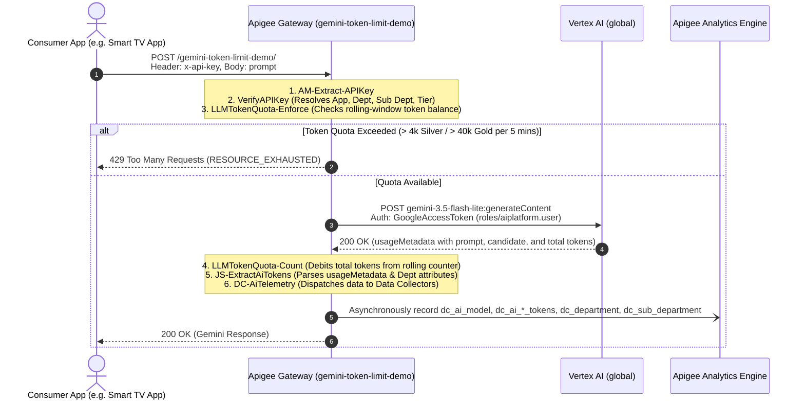
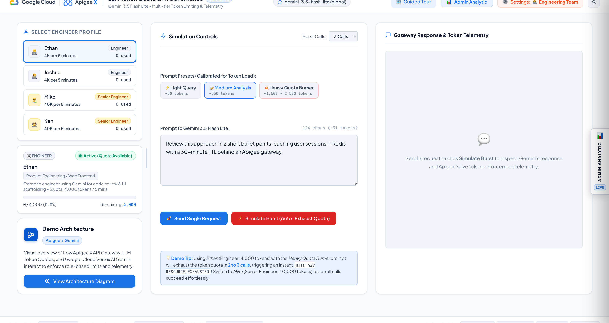
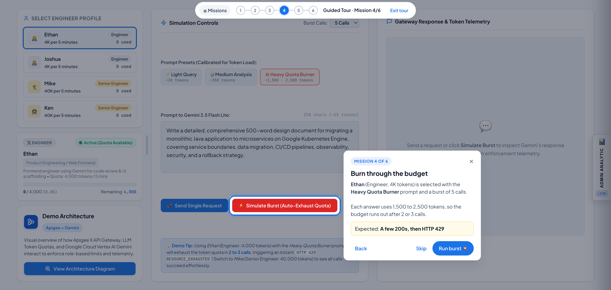

# Apigee LLM Token Quota & AI Telemetry Demo (`gemini-token-limit-demo`)

This repository contains the complete Apigee API Proxy bundle, declarative API Product configurations, and Developer App definitions with custom attributes for **LLM Token Quota Governance** and **AI Analytics Data Collection** connecting to Google Vertex AI Gemini 3.5 Flash Lite via the `global` endpoint.

Deployed and operational in Apigee organization: **`YOUR_APIGEE_ORG`** (Environment: **`default-dev`**).

It also includes an interactive Web UI (see below) with a 🗺️ Guided Tour, ⚙️ scenario presets to relabel the demo for different audiences, and 📊 Admin Analytic (aggregated and per-app token usage).

---

## 🏛️ Architecture Diagram & Policy Flow

<p align="center">
  
</p>

### End-to-End Policy Execution Pipeline

This implementation references the enterprise patterns from `AI-Gemini-Reference` (revision 2), incorporating `VerifyAPIKey`, paired `LLMTokenQuota` (Enforce & Count), JavaScript token extraction, and Apigee Analytics `DataCapture` (telemetry for model, prompt/response/total tokens, and app custom attributes: Department & Sub Department).



---

## 📋 Pre-requisites

Before deploying or running this demo, ensure the following infrastructure and access requirements are satisfied:

### 1. Google Cloud Platform & Apigee X Environment
* **GCP Project**: An active Google Cloud project with billing enabled (e.g., `YOUR_GCP_PROJECT_ID`).
* **Apigee Organization**: A provisioned Apigee X or hybrid organization attached to the project.
* **Apigee Environment**: At least one active environment (e.g., `default-dev`) with an environment group mapped to an ingress hostname or IP (e.g., `YOUR_APIGEE_GATEWAY_HOST`).

### 2. Enabled Google Cloud APIs
Enable the required APIs in your GCP project:
```bash
gcloud services enable \
  apigee.googleapis.com \
  aiplatform.googleapis.com \
  run.googleapis.com \
  iap.googleapis.com \
  iam.googleapis.com
```

### 3. IAM Roles & Service Account Bindings
* **Apigee Runtime Service Account**:
  * An authorized Service Account (e.g., `sa-apigee-aiservices@YOUR_GCP_PROJECT_ID.iam.gserviceaccount.com` or the Apigee Service Agent) must have the **Vertex AI User** role to invoke Gemini:
    ```bash
    gcloud projects add-iam-policy-binding <PROJECT_ID> \
      --member="serviceAccount:sa-apigee-aiservices@<PROJECT_ID>.iam.gserviceaccount.com" \
      --role="roles/aiplatform.user"
    ```
* **Deployment Identity**:
  * Your deployment account or CI/CD identity requires **Apigee Organization Admin** (`roles/apigee.admin`).
* **Cloud Run & IAP Access (Web UI)**:
  * For the hosted dashboard, users require **IAP-secured Web App User** (`roles/iap.httpsResourceAccessor`) to pass Google Identity-Aware Proxy authentication.

### 4. Apigee Analytics Data Collectors
The organization must have the 6 Data Collectors registered so `DC-AiTelemetry.xml` can record custom dimensions:
* `dc_ai_model` (`STRING`)
* `dc_ai_prompt_token_count` (`INTEGER`)
* `dc_ai_response_token_count` (`INTEGER`)
* `dc_ai_total_token_count` (`INTEGER`)
* `dc_department` (`STRING`)
* `dc_sub_department` (`STRING`)

*Note: In `YOUR_APIGEE_ORG`, these Data Collectors are already provisioned and receiving live telemetry.*

### 5. Local Workstation Tools
* **`gcloud` CLI**: [Google Cloud SDK](https://cloud.google.com/sdk) authenticated with `gcloud auth login`.
* **`apigeecli`** (Optional but recommended): For automated proxy deployment and declarative product setup (`brew install apigeecli` or [GitHub releases](https://github.com/apigee/apigeecli)).
* **Python 3.10+**: For running the interactive Web-UI server locally (`web-ui/.venv`).
* **`curl` & `bash`**: Standard command-line tools for running verification suites (`./test-quota.sh`).

---

## 📊 Data Collectors & Analytics Telemetry

Configured in `DC-AiTelemetry.xml` and registered in `YOUR_APIGEE_ORG`:

| Data Collector Name | Type | Description | Source Flow Variable |
| :--- | :--- | :--- | :--- |
| **`dc_ai_model`** | `STRING` | LLM Model Name | `ai.model` (`gemini-3.5-flash-lite`) |
| **`dc_ai_prompt_token_count`** | `INTEGER` | Input / Prompt tokens | `ai.promptTokenCount` |
| **`dc_ai_response_token_count`** | `INTEGER` | Generated / Completion tokens | `ai.responseTokenCount` |
| **`dc_ai_total_token_count`** | `INTEGER` | Total tokens consumed | `ai.totalTokenCount` |
| **`dc_department`** | `STRING` | Consumer Department | `ai.department` (`verifyapikey.VerifyAPIKey.Department`) |
| **`dc_sub_department`** | `STRING` | Consumer Sub Department | `ai.subDepartment` (`verifyapikey.VerifyAPIKey.Sub Department`) |

---

## 📦 Provisioned API Products

Both products configure both standard Proxy Operation Groups and LLM Operation Groups (`llmOperationGroup`) with token quotas:

| API Product | Quota Limit | Interval | Environment | Operations |
| :--- | :--- | :--- | :--- | :--- |
| **`Gemini-Silver-Tier`** | **4,000 tokens** | **5 minutes** | `default-dev` | `/` and `/**` on `gemini-token-limit-demo` |
| **`Gemini-Gold-Tier`** | **40,000 tokens** | **5 minutes** | `default-dev` | `/` and `/**` on `gemini-token-limit-demo` |

---

## 📱 Developer Applications & Credentials

Provisioned under developer **`developer@example.com`** in **`YOUR_APIGEE_ORG`**:

### Silver Tier Apps (4,000 tokens / 5 mins)
1. **`Gemini-Basic-Mfg-SmartTV-App`**
   * **API Key (`consumerKey`)**: `YOUR_SMART_TV_APP_API_KEY`
   * **Product**: `Gemini-Silver-Tier`
   * **Attributes**:
     * `Department`: `Manufacturing`
     * `Sub Department`: `Smart TV division`

2. **`Gemini-Basic-Mfg-AudioSignal-App`**
   * **API Key (`consumerKey`)**: `YOUR_AUDIO_SIGNAL_APP_API_KEY`
   * **Product**: `Gemini-Silver-Tier`
   * **Attributes**:
     * `Department`: `Manufacturing`
     * `Sub Department`: `AudioSignal division`

### Gold Tier Apps (40,000 tokens / 5 mins)
3. **`Gemini-Premium-Network-Core-App`**
   * **API Key (`consumerKey`)**: `YOUR_NETWORK_CORE_APP_API_KEY`
   * **Product**: `Gemini-Gold-Tier`
   * **Attributes**:
     * `Department`: `Network`
     * `Sub Department`: `Core division`

4. **`Gemini-Premium-Network-Wireless-App`**
   * **API Key (`consumerKey`)**: `YOUR_NETWORK_WIRELESS_APP_API_KEY`
   * **Product**: `Gemini-Gold-Tier`
   * **Attributes**:
     * `Department`: `Network`
     * `Sub Department`: `Wireless division`

---

## 🚀 Live Verification & Usage

### 1. Test Without API Key (401 Unauthorized)
```bash
curl -k -i -X POST "https://YOUR_APIGEE_GATEWAY_HOST/gemini-token-limit-demo/" \
  -H "Content-Type: application/json" \
  -d '{"contents":[{"role":"user","parts":[{"text":"Hi"}]}]}'
```
**Response:**
```json
{
  "error": {
    "code": 401,
    "message": "Invalid or missing API key. Please provide a valid 'x-api-key' header.",
    "status": "UNAUTHENTICATED"
  }
}
```

### 2. Test With SmartTV App API Key (Silver Tier: 4,000 tokens)
```bash
curl -k -i -X POST "https://YOUR_APIGEE_GATEWAY_HOST/gemini-token-limit-demo/" \
  -H "Content-Type: application/json" \
  -H "x-api-key: YOUR_SMART_TV_APP_API_KEY" \
  -d '{
    "contents": [
      {
        "role": "user",
        "parts": [{"text": "Summarize how Apigee manages token quotas in 1 sentence."}]
      }
    ]
  }'
```
**Response:**
```json
{
  "candidates": [
    {
      "content": {
        "parts": [
          {
            "text": "Apigee manages token quotas by enforcing request limits and dynamically counting token consumption via the LLMTokenQuota policy integrated with API Products."
          }
        ],
        "role": "model"
      },
      "finishReason": "STOP"
    }
  ],
  "usageMetadata": {
    "promptTokenCount": 15,
    "candidatesTokenCount": 27,
    "totalTokenCount": 42
  },
  "modelVersion": "gemini-3.5-flash-lite"
}
```

### 3. Test With Network Core App API Key (Gold Tier: 40,000 tokens)
```bash
curl -k -i -X POST "https://YOUR_APIGEE_GATEWAY_HOST/gemini-token-limit-demo/" \
  -H "Content-Type: application/json" \
  -H "x-api-key: YOUR_NETWORK_CORE_APP_API_KEY" \
  -d '{
    "contents": [
      {
        "role": "user",
        "parts": [{"text": "Hello from Network Core"}]
      }
    ]
  }'
```

### 4. Running the Complete Verification Suite
To test all 4 apps and error handling automatically:
```bash
./test-quota.sh
```

---

## 🖥️ Interactive Web UI & Admin Analytic

<p align="center">
  
</p>

The Web UI (`web-ui/`, Flask + vanilla JS) lets you send prompts through the Apigee proxy as any of the 4 developer apps, watch each app's 5-minute token budget fill up, hit HTTP 429, and explore the resulting analytics.

| Area | What it shows |
| :--- | :--- |
| **Left panel** | The 4 developer apps as profiles (e.g. *Select Engineer Profile*), the live 5-minute quota meter for the selected app, and **View Architecture Diagram** |
| **Simulation Controls** | Prompt presets, the prompt box, **Send Single Request** and **Simulate Burst** (3, 4, 5 or 8 calls) |
| **Gateway Response & Token Telemetry** | Gemini's answer, prompt / response / total tokens, HTTP status and latency, or the 429 alert |
| **🗺️ Guided Tour** (header) | A 6-mission walkthrough of the demo |
| **📊 Admin Analytic** (header or right-edge tab) | One drawer with **Aggregated** and **App-Specific** tabs |
| **⚙️ Settings** (header) | Scenario presets that relabel products, apps and attributes for your audience |

---

### 🗺️ Guided Tour

<p align="center">
  
</p>

A spotlight-and-coachmark tour, in the same style as the Model Armor and Coffee Shop demos. It opens automatically on the first visit in each browser session and can be reopened from **🗺️ Guided Tour** in the header.

| # | Mission | What the user does | Completes when |
| :--- | :--- | :--- | :--- |
| 1 | Meet the architecture | Opens the architecture diagram | The diagram opens |
| 2 | Pick a scenario | Opens ⚙️ Settings and applies a preset | **Apply scenario** is clicked |
| 3 | Send a prompt | Picks a 4K profile and sends one *Light Query* | The request returns |
| 4 | Hit the limit | Bursts the *Heavy Quota Burner* prompt on a 4K profile | A call returns **HTTP 429** |
| 5 | Compare tiers | Repeats the burst on a 40K profile | Every call returns **200** |
| 6 | See the analytics | Opens Admin Analytic and switches to **App-Specific** | The tab is clicked |

* The tour sets up each step for you (profile, prompt preset, burst size), and step text uses the active scenario's labels.
* After each mission, a **"What just happened?"** panel explains the policy flow using numbers from your actual run.
* Progress is saved in the browser, so a reload resumes where you left off. **☰ Missions** jumps to any mission.
* URL options: `?tour=limit` (or any mission id: `architecture`, `scenario`, `single`, `limit`, `tiers`, `analytics`) starts at that mission; `?tour=0` stops the welcome screen from opening automatically.

Source: [`web-ui/static/tour/`](web-ui/static/tour/) — `tour-engine.js` (rendering and sequencing), `tour-missions.js` (mission content), `tour.css` (styles).

---

### ⚙️ Scenario Settings (display labels only)

The same two API products and four developer apps can tell different stories. Pick a preset in **⚙️ Settings**, or choose **Custom** to type your own names. **Reset to original** returns to the default.

| Preset | 4K product shown as | 40K product shown as | The 4 apps shown as |
| :--- | :--- | :--- | :--- |
| 👩‍💻 **Engineering Team** (default) | Engineer | Senior Engineer | Ethan, Joshua, Mike, Ken |
| 💳 **SaaS Customer Plans** | Free Plan | Enterprise Plan | Acme Startup, Bluebird Studio, Contoso Bank, Globex Retail |
| 🏦 **Banking Staff** | Relationship Manager | Private Banker | Sarah, David, Grace, Daniel |
| 🎓 **University** | Student | Professor | Alice, Ben, Dr. Chen, Prof. Davis |
| 📡 **High Tech Manufacturing Department** | Silver | Gold | Smart TV App, Audio Signal App, Network Core App, Network Wireless App |

Each preset also renames the two custom attribute labels (e.g. *Team* / *Squad*) and swaps the sample prompts.

> [!NOTE]
> Settings only change what the browser displays. The Apigee API products, developer apps, quotas and custom attribute values are not modified, and the choice is stored in the browser's `localStorage`. Presets are defined in [`web-ui/static/js/scenarios.js`](web-ui/static/js/scenarios.js).

---

### 📖 Step-by-Step Demo Script

The Guided Tour covers the same flow. Labels below use the default **Engineering Team** preset.

```
┌──────────────────────────┐     ┌─────────────────────────┐     ┌─────────────────────────┐
│ 1. Pick a profile        │ ──► │ 2. Pick a prompt preset │ ──► │ 3. Send or burst        │
│ (Engineer 4K / Senior 40K)│    │ (Light / Medium / Heavy)│     │ (real Apigee calls)     │
└──────────────────────────┘     └─────────────────────────┘     └─────────────────────────┘
                                                                              │
                                                                              ▼
┌──────────────────────────┐     ┌─────────────────────────┐     ┌─────────────────────────┐
│ 6. Admin Analytic        │ ◄── │ 5. Compare with 40K     │ ◄── │ 4. Hit HTTP 429         │
│ (Aggregated/App-Specific)│     │ (same burst, all 200s)  │     │ (meter turns red)       │
└──────────────────────────┘     └─────────────────────────┘     └─────────────────────────┘
```

#### Step 1: Pick a profile
1. In the left panel, pick a profile. **Ethan** and **Joshua** use the 4K product (`Gemini-Silver-Tier`); **Mike** and **Ken** use the 40K product (`Gemini-Gold-Tier`). Drag the vertical splitter to resize the panel.
2. The quota meter below shows the selected app's rolling usage, e.g. `0 / 4,000 (0.0%)`.

#### Step 2: Choose a prompt preset
* ⚡ **Light Query** (`~30 tokens`): a short question.
* 📝 **Medium Analysis** (`~350 tokens`): a short technical analysis.
* 💥 **Heavy Quota Burner** (`~1,500 - 2,500 tokens`): a long design-document prompt that uses up a 4K budget quickly.

#### Step 3: Send traffic
* **Send Single Request**: Apigee verifies the API key, checks the budget, calls Gemini 3.5 Flash Lite (`global` endpoint), debits `totalTokenCount`, and records telemetry. The response panel shows the answer and token counts; the quota meter then updates.
* **Simulate Burst**: sends 3, 4, 5 or 8 calls in a row (choose in **Burst Calls**) and stops at the first 429.

#### Step 4: Hit the limit (HTTP 429)
1. Select **Ethan** (4K), choose **Heavy Quota Burner**, and run a burst of 3 to 5 calls.
2. After 2 or 3 calls the budget is used up and `LLMTokenQuota-Enforce` rejects the next call before Gemini is invoked:
   * **HTTP status**: `429`, `"status": "RESOURCE_EXHAUSTED"`
   * **Message**: `LLM Token Quota limit exceeded for your tier. Please retry after your 5-minute quota window resets.`
3. The meter turns red, the status shows **Quota Exhausted (HTTP 429)**, and the alert offers a quick switch to a 40K profile.

#### Step 5: Compare with the 40K product
Select **Mike** or **Ken** and run the same burst. Every call succeeds, because `Gemini-Gold-Tier` allows 10× the tokens. Same proxy, same policies; only the API product differs.

#### Step 6: Explore Admin Analytic
1. Click **📊 Admin Analytic** in the header (or the tab on the right edge).
2. **Aggregated** tab: pick a window (`Last 1 Hour`, `1 Day`, `3 Days`, `7 Days`) and review:
   * KPIs: total requests, total tokens, quota violations (429s), average latency.
   * Tokens by API product, by developer app, and by the two custom attributes.
   * Token consumption timeline and the **Detailed Transaction Audit Ledger**.
3. **App-Specific** tab: pick one app to see its calls, tokens, live 5-minute quota status, latency and hourly token velocity.
4. **Reset Demo Data** (Aggregated tab) clears live test traffic and restores the 7-day demo baseline.

---

## 🏛️ Updating the Architecture Diagram

`docs/images/architecture.png` (also copied to `web-ui/static/assets/architecture.png` for the in-app pop-up) is rendered from an editable HTML source, so text stays crisp and logos are the real ones:

```bash
# 1. Edit docs/diagram/architecture.html
# 2. Render it with headless Chrome (2x for sharp text)
"/Applications/Google Chrome.app/Contents/MacOS/Google Chrome" --headless=new --hide-scrollbars \
  --allow-file-access-from-files --force-device-scale-factor=2 --window-size=1600,560 \
  --screenshot=docs/images/architecture.png "file://$PWD/docs/diagram/architecture.html"
# 3. Copy it into the Web UI
cp docs/images/architecture.png web-ui/static/assets/architecture.png
```

If you change the canvas height, update the `--window-size` height, `html, body { height }` and the arrow `<svg viewBox>` in the HTML together so the arrows stay aligned.

---

## 🚀 Launching the Web UI

### Option A: Cloud Run (secured with IAP)
The UI is deployed to **Google Cloud Run** in `asia-southeast1` within project `YOUR_GCP_PROJECT_ID`, secured with **Identity-Aware Proxy (IAP)**:
* **Service Name**: `apigee-token-limit-demo-ui`
* **Region**: `asia-southeast1`
* **Direct Cloud Run URL**: **[https://apigee-token-limit-demo-ui-PROJECT_NUMBER.asia-southeast1.run.app](https://apigee-token-limit-demo-ui-PROJECT_NUMBER.asia-southeast1.run.app)**
* **Authentication**: Google Identity-Aware Proxy (IAP). Open the URL while signed in with an authorized Google account.

To deploy a new revision from source (keeps the existing IAP, scaling and service account settings):
```bash
gcloud run deploy apigee-token-limit-demo-ui \
  --source web-ui \
  --region asia-southeast1 \
  --project YOUR_APIGEE_ORG
```

> [!NOTE]
> Each environment keeps its own transaction ledger (SQLite inside the container), so Admin Analytic on Cloud Run and on your laptop show different live traffic.

### Option B: Local
```bash
./run-ui.sh

# Or specify a custom port:
PORT=8089 ./run-ui.sh
```
Then open **[http://localhost:8089](http://localhost:8089)** in your browser.

---

## 📁 Repository Layout

| Path | Contents |
| :--- | :--- |
| `gemini-token-limit-demo/apiproxy/` | Apigee proxy bundle (policies, proxy and target endpoints, JavaScript) |
| `products/` | API product definitions (`Gemini-Silver-Tier`, `Gemini-Gold-Tier`) |
| `apps/` | Developer app definitions with custom attributes |
| `deploy.sh` | Upload and deploy the proxy with `apigeecli` |
| `setup-products-and-apps.sh` | Create the API products and developer apps |
| `test-quota.sh` | Command-line verification of all 4 apps and error handling |
| `run-ui.sh` | Start the Web UI locally |
| `web-ui/` | Flask app (`app.py`), `Dockerfile`, and static front end (`static/`) |
| `web-ui/static/js/scenarios.js` | ⚙️ Settings presets |
| `web-ui/static/tour/` | Guided Tour engine, missions and styles |
| `docs/diagram/architecture.html` | Editable source for the architecture diagram |
| `docs/images/` | Architecture diagram and Web UI screenshots |
