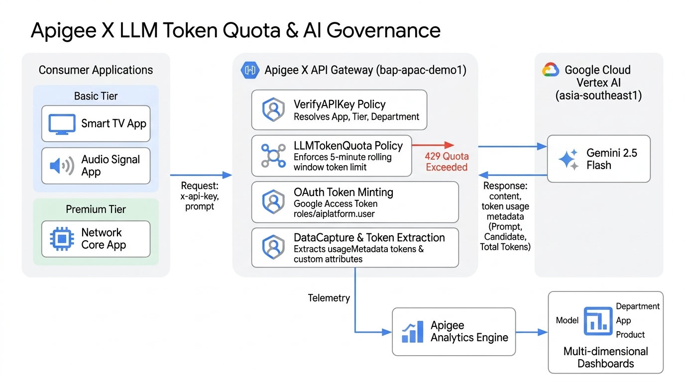
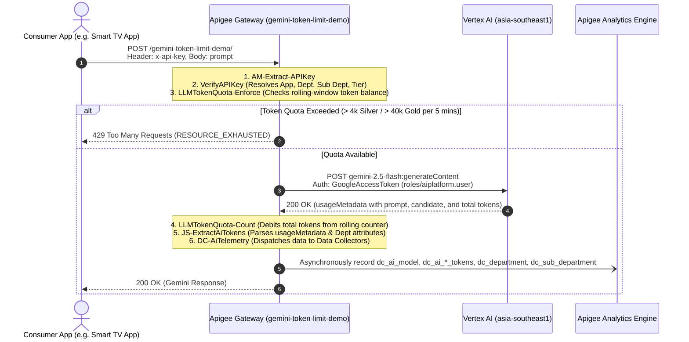

# Apigee LLM Token Quota & AI Telemetry Demo (`gemini-token-limit-demo`)

This repository contains the complete Apigee API Proxy bundle, declarative API Product configurations, and Developer App definitions with custom attributes for **LLM Token Quota Governance** and **AI Analytics Data Collection** connecting to Google Vertex AI Gemini in `asia-southeast1`.

Deployed and operational in Apigee organization: **`YOUR_APIGEE_ORG`** (Environment: **`default-dev`**).

---

## 🏛️ Architecture Diagram & Policy Flow

<p align="center">
  
</p>

### End-to-End Policy Execution Pipeline

This implementation references the enterprise patterns from `AI-Gemini-Reference` (revision 2), incorporating `VerifyAPIKey`, paired `LLMTokenQuota` (Enforce & Count), JavaScript token extraction, and Apigee Analytics `DataCapture` (telemetry for model, prompt/response/total tokens, and app custom attributes: Department & Sub Department).



---

## 📋 Pre-requisites

Before deploying or running this demo, ensure the following infrastructure and access requirements are satisfied:

### 1. Google Cloud Platform & Apigee X Environment
* **GCP Project**: An active Google Cloud project with billing enabled (e.g., `YOUR_GCP_PROJECT_ID`).
* **Apigee Organization**: A provisioned Apigee X or hybrid organization attached to the project.
* **Apigee Environment**: At least one active environment (e.g., `default-dev`) with an environment group mapped to an ingress hostname or IP (e.g., `YOUR_APIGEE_GATEWAY_HOST`).

### 2. Enabled Google Cloud APIs
Enable the required APIs in your GCP project:
```bash
gcloud services enable \
  apigee.googleapis.com \
  aiplatform.googleapis.com \
  run.googleapis.com \
  iap.googleapis.com \
  iam.googleapis.com
```

### 3. IAM Roles & Service Account Bindings
* **Apigee Runtime Service Account**:
  * An authorized Service Account (e.g., `sa-apigee-aiservices@YOUR_GCP_PROJECT_ID.iam.gserviceaccount.com` or the Apigee Service Agent) must have the **Vertex AI User** role to invoke Gemini:
    ```bash
    gcloud projects add-iam-policy-binding <PROJECT_ID> \
      --member="serviceAccount:sa-apigee-aiservices@<PROJECT_ID>.iam.gserviceaccount.com" \
      --role="roles/aiplatform.user"
    ```
* **Deployment Identity**:
  * Your deployment account or CI/CD identity requires **Apigee Organization Admin** (`roles/apigee.admin`).
* **Cloud Run & IAP Access (Web UI)**:
  * For the hosted dashboard, users require **IAP-secured Web App User** (`roles/iap.httpsResourceAccessor`) to pass Google Identity-Aware Proxy authentication.

### 4. Apigee Analytics Data Collectors
The organization must have the 6 Data Collectors registered so `DC-AiTelemetry.xml` can record custom dimensions:
* `dc_ai_model` (`STRING`)
* `dc_ai_prompt_token_count` (`INTEGER`)
* `dc_ai_response_token_count` (`INTEGER`)
* `dc_ai_total_token_count` (`INTEGER`)
* `dc_department` (`STRING`)
* `dc_sub_department` (`STRING`)

*Note: In `YOUR_APIGEE_ORG`, these Data Collectors are already provisioned and receiving live telemetry.*

### 5. Local Workstation Tools
* **`gcloud` CLI**: [Google Cloud SDK](https://cloud.google.com/sdk) authenticated with `gcloud auth login`.
* **`apigeecli`** (Optional but recommended): For automated proxy deployment and declarative product setup (`brew install apigeecli` or [GitHub releases](https://github.com/apigee/apigeecli)).
* **Python 3.10+**: For running the interactive Web-UI server locally (`web-ui/.venv`).
* **`curl` & `bash`**: Standard command-line tools for running verification suites (`./test-quota.sh`).

---

## 📊 Data Collectors & Analytics Telemetry

Configured in `DC-AiTelemetry.xml` and registered in `YOUR_APIGEE_ORG`:

| Data Collector Name | Type | Description | Source Flow Variable |
| :--- | :--- | :--- | :--- |
| **`dc_ai_model`** | `STRING` | LLM Model Name | `ai.model` (`gemini-2.5-flash`) |
| **`dc_ai_prompt_token_count`** | `INTEGER` | Input / Prompt tokens | `ai.promptTokenCount` |
| **`dc_ai_response_token_count`** | `INTEGER` | Generated / Completion tokens | `ai.responseTokenCount` |
| **`dc_ai_total_token_count`** | `INTEGER` | Total tokens consumed | `ai.totalTokenCount` |
| **`dc_department`** | `STRING` | Consumer Department | `ai.department` (`verifyapikey.VerifyAPIKey.Department`) |
| **`dc_sub_department`** | `STRING` | Consumer Sub Department | `ai.subDepartment` (`verifyapikey.VerifyAPIKey.Sub Department`) |

---

## 📦 Provisioned API Products

Both products configure both standard Proxy Operation Groups and LLM Operation Groups (`llmOperationGroup`) with token quotas:

| API Product | Quota Limit | Interval | Environment | Operations |
| :--- | :--- | :--- | :--- | :--- |
| **`Gemini-Silver-Tier`** | **4,000 tokens** | **5 minutes** | `default-dev` | `/` and `/**` on `gemini-token-limit-demo` |
| **`Gemini-Gold-Tier`** | **40,000 tokens** | **5 minutes** | `default-dev` | `/` and `/**` on `gemini-token-limit-demo` |

---

## 📱 Developer Applications & Credentials

Provisioned under developer **`developer@example.com`** in **`YOUR_APIGEE_ORG`**:

### Silver Tier Apps (4,000 tokens / 5 mins)
1. **`Gemini-Basic-Mfg-SmartTV-App`**
   * **API Key (`consumerKey`)**: `YOUR_SMART_TV_APP_API_KEY`
   * **Product**: `Gemini-Silver-Tier`
   * **Attributes**:
     * `Department`: `Manufacturing`
     * `Sub Department`: `Smart TV division`

2. **`Gemini-Basic-Mfg-AudioSignal-App`**
   * **API Key (`consumerKey`)**: `YOUR_AUDIO_SIGNAL_APP_API_KEY`
   * **Product**: `Gemini-Silver-Tier`
   * **Attributes**:
     * `Department`: `Manufacturing`
     * `Sub Department`: `AudioSignal division`

### Gold Tier Apps (40,000 tokens / 5 mins)
3. **`Gemini-Premium-Network-Core-App`**
   * **API Key (`consumerKey`)**: `YOUR_NETWORK_CORE_APP_API_KEY`
   * **Product**: `Gemini-Gold-Tier`
   * **Attributes**:
     * `Department`: `Network`
     * `Sub Department`: `Core division`

4. **`Gemini-Premium-Network-Wireless-App`**
   * **API Key (`consumerKey`)**: `YOUR_NETWORK_WIRELESS_APP_API_KEY`
   * **Product**: `Gemini-Gold-Tier`
   * **Attributes**:
     * `Department`: `Network`
     * `Sub Department`: `Wireless division`

---

## 🚀 Live Verification & Usage

### 1. Test Without API Key (401 Unauthorized)
```bash
curl -k -i -X POST "https://YOUR_APIGEE_GATEWAY_HOST/gemini-token-limit-demo/" \
  -H "Content-Type: application/json" \
  -d '{"contents":[{"role":"user","parts":[{"text":"Hi"}]}]}'
```
**Response:**
```json
{
  "error": {
    "code": 401,
    "message": "Invalid or missing API key. Please provide a valid 'x-api-key' header.",
    "status": "UNAUTHENTICATED"
  }
}
```

### 2. Test With SmartTV App API Key (Silver Tier: 4,000 tokens)
```bash
curl -k -i -X POST "https://YOUR_APIGEE_GATEWAY_HOST/gemini-token-limit-demo/" \
  -H "Content-Type: application/json" \
  -H "x-api-key: YOUR_SMART_TV_APP_API_KEY" \
  -d '{
    "contents": [
      {
        "role": "user",
        "parts": [{"text": "Summarize how Apigee manages token quotas in 1 sentence."}]
      }
    ]
  }'
```
**Response:**
```json
{
  "candidates": [
    {
      "content": {
        "parts": [
          {
            "text": "Apigee manages token quotas by enforcing request limits and dynamically counting token consumption via the LLMTokenQuota policy integrated with API Products."
          }
        ],
        "role": "model"
      },
      "finishReason": "STOP"
    }
  ],
  "usageMetadata": {
    "promptTokenCount": 15,
    "candidatesTokenCount": 27,
    "totalTokenCount": 42
  },
  "modelVersion": "gemini-2.5-flash"
}
```

### 3. Test With Network Core App API Key (Gold Tier: 40,000 tokens)
```bash
curl -k -i -X POST "https://YOUR_APIGEE_GATEWAY_HOST/gemini-token-limit-demo/" \
  -H "Content-Type: application/json" \
  -H "x-api-key: YOUR_NETWORK_CORE_APP_API_KEY" \
  -d '{
    "contents": [
      {
        "role": "user",
        "parts": [{"text": "Hello from Network Core"}]
      }
    ]
  }'
```

### 4. Running the Complete Verification Suite
To test all 4 apps and error handling automatically:
```bash
./test-quota.sh
```

---

## 🖥️ Interactive Web-UI & Admin Analytics Dashboard

A dedicated, full-featured web application is included to demonstrate **Token Quota Simulation** and **Multi-dimensional Admin Analytics**.

### 1. Cloud Run Deployment with Identity-Aware Proxy (IAP)
The UI is deployed directly to **Google Cloud Run** in `asia-southeast1` within project `YOUR_GCP_PROJECT_ID` secured with **Identity-Aware Proxy (IAP)**:
* **Service Name**: `apigee-token-limit-demo-ui`
* **Region**: `asia-southeast1`
* **Direct Cloud Run URL**: **[https://apigee-token-limit-demo-ui-PROJECT_NUMBER.asia-southeast1.run.app](https://apigee-token-limit-demo-ui-PROJECT_NUMBER.asia-southeast1.run.app)**
* **Authentication Mechanism**: Google Identity-Aware Proxy (IAP).
  * Direct invocation on the Cloud Run service is locked down to the Google IAP Service Agent (`service-PROJECT_NUMBER@gcp-sa-iap.iam.gserviceaccount.com`).
  * End-user browser access is governed by the `roles/iap.httpsResourceAccessor` role, specifically granted to `developer@example.com`.
* **Direct Access**: Simply navigate to the URL in your browser logged in as `developer@example.com`. Google IAP will seamlessly authenticate your session without requiring intermediate proxies or manual token headers.

### 2. Local Development Launch
To launch locally anytime from terminal:
```bash
./run-ui.sh
# Or specify a custom port:
PORT=8089 ./run-ui.sh
```
Then open **[http://localhost:8089](http://localhost:8089)**.

### 3. Features

#### ⚡ Tab 1: Token Quota Simulator
* **Interactive App Selector**:
  * **Basic Apps (Silver Tier - 4,000 tokens / 5 mins)**:
    * `Gemini-Basic-Mfg-SmartTV-App` (Manufacturing / Smart TV division)
    * `Gemini-Basic-Mfg-AudioSignal-App` (Manufacturing / AudioSignal division)
  * **Premium Apps (Gold Tier - 40,000 tokens / 5 mins - 10x capacity)**:
    * `Gemini-Premium-Network-Core-App` (Network / Core division)
    * `Gemini-Premium-Network-Wireless-App` (Network / Wireless division)
* **Live Quota Usage Gauge**:
  * Shows rolling 5-minute token consumption vs tier limit (`Tokens Used / Limit (Percentage)`).
  * Real-time animated bar: Green (OK) → Amber (Warning >60%) → Crimson Red (Exhausted >85% / 429).
* **Quota Exhaustion Demonstration**:
  * Use **Simulate Burst (Auto-Exhaust Quota)** with the *Heavy Quota Burner* prompt on a Basic App.
  * In **2 to 3 calls**, the 4,000-token limit is breached.
  * Apigee triggers **`HTTP 429 RESOURCE_EXHAUSTED`** (`policies.ratelimit.QuotaViolation`).
  * A 1-click upgrade button allows instantly switching to **`Gemini-Premium-Network-Core-App` (Gold Tier)** to verify that the identical burst completes successfully!

#### 📊 Tab 2: Admin Analytics Dashboard
* **Time Duration Filter**:
  * Toggle between: `Last 1 Hour`, `Last 1 Day`, `Last 3 Days`, `Last 7 Days`.
* **Multi-Dimensional Visualizations (Chart.js)**:
  1. **By API Product**: `Gemini-Silver-Tier` vs `Gemini-Gold-Tier`
  2. **By Developer App**: SmartTV vs AudioSignal vs Network-Core vs Network-Wireless
  3. **By Department**: `Manufacturing` vs `Network` (Organizational cost & consumption governance)
  4. **By Sub-Department**: `Smart TV division`, `AudioSignal division`, `Core division`, `Wireless division`
  5. **Timeline Trend**: Token consumption volume across time buckets.
* **Audit Transaction Ledger**:
  * Filterable, searchable table displaying Timestamp, App, Product, Department, Sub-Department, Tokens (Prompt / Response / Total), Status (200 OK vs 429 Quota Exceeded), and Latency.

